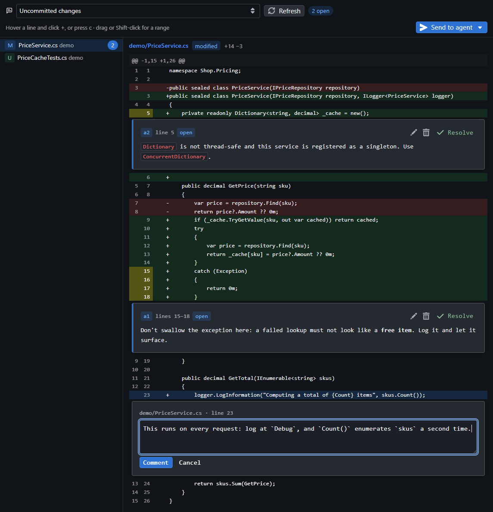
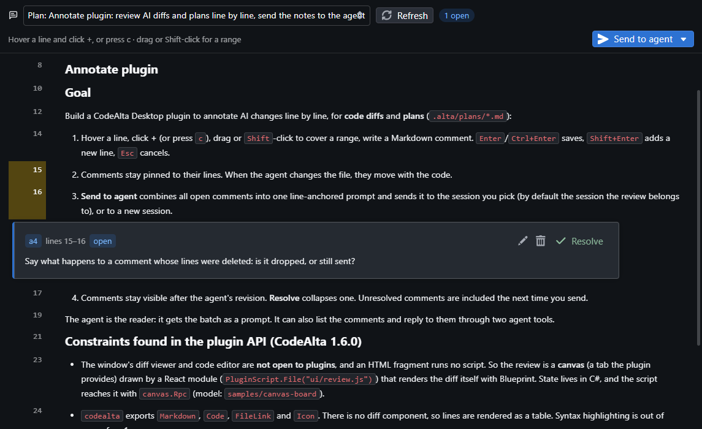
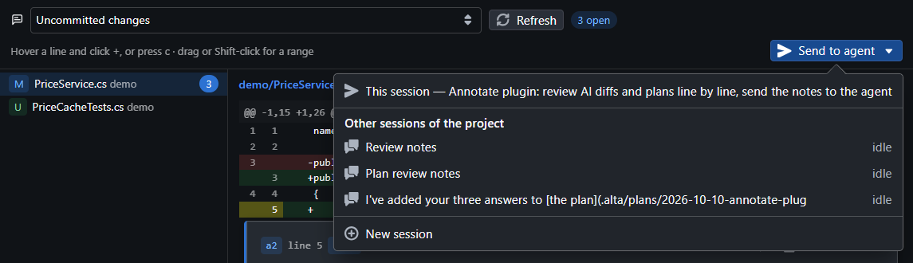
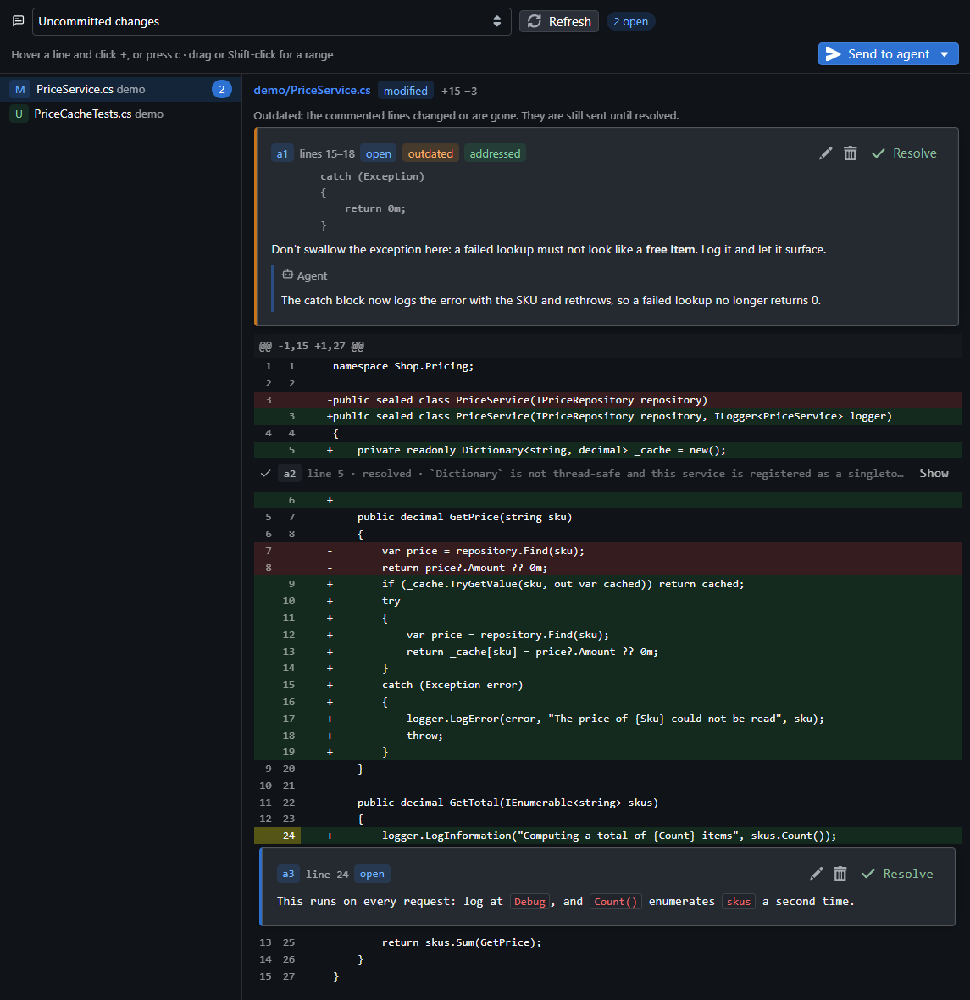

# Annotate

## Native integration 

- [Spec for the native integration](docs/spec-annotations.md)
- [Implementation plan for CodeAlta](docs/2026-10-11-native-annotations.md)
- [Implementation plan for the plugin](.alta/plans/2026-10-11-annotate-handover.md)

## Plugin spike

Review what an agent changed, line by line, and send your comments back to it as one prompt. It works for three things:

- **Code changes:** the uncommitted state of the project against `HEAD`, staged or not, with untracked files shown as added.
- **Plans:** a file in `.alta/plans/`, split into Markdown blocks (headings, paragraphs, list items, tables, code).
- **Markdown files:** any other `.md` or `.markdown` file of the project, such as a README or a design doc, shown like a plan.

CodeAlta Desktop only: the review is a canvas tab.



### Install

The plugin is a global plugin, so it works in every project. Its folder is `~/.alta/plugins/annotate/` (`plugin.cs`, `review-content.cs` and `ui/review.js`). To develop it from this repository, link the folder:

```powershell
New-Item -ItemType Junction -Path "$HOME\.alta\plugins\annotate" -Target "<repo>\annotate"
```

Then run `alta plugin reload annotate`, or restart CodeAlta.

### Open a review

| From | Does |
|---|---|
| `/annotate` in a session, or **Annotate: review the changes** in the palette | Opens the review of the uncommitted changes for that session. |
| `/annotate-plan`, or **Annotate: review a plan** | Asks which plan of `.alta/plans/` to review, then opens it. |
| `/annotate-file`, or **Annotate: review a Markdown file** | Asks which Markdown file of the project to review, then opens it. The list has the files git does not ignore, plans excepted, up to 500. |
| **Annotate changes** in the menu of a session row | Opens the review of the changes for that session. Its badge counts the unresolved comments. |
| **Review · N comments** in the status line of a session | Shown while the session has unresolved comments. A click opens the review. |
| The selector at the top left of a review | Switches between the changes, the plans and the Markdown files of the project, each in its own tab. |

No shortcut is bound by default.

A plan review shows the plan as Markdown, one block per row with its line numbers. A comment covers whole blocks. A Markdown file is shown the same way:



### Comment

| To | Do |
|---|---|
| Comment on a line | Hover the line and click **+**, or focus the line and press `c`. |
| Comment on a range | Drag from one **+** to another line, or click a line and Shift-click the **+** of another. A range stays inside one hunk of the diff. |
| Move between lines | `↑` and `↓` on a focused line. |
| Save | `Enter` or `Ctrl+Enter`. |
| Add a line to the comment | `Shift+Enter`. |
| Cancel | `Esc`. |

Comments are Markdown. Each one shows under the last line of its range, with **Edit**, **Delete** and **Resolve**. A resolved comment folds into one line. **Show** opens it again, and **Reopen** makes it unresolved.

Comments stay with their lines. When the file changes, a comment follows its text (the match nearest to where it was wins). When the text is gone, the comment shows under **Outdated** with the lines it was about. It is still sent until you resolve it, and it attaches again if the text comes back.

The review reads the files again when its tab is shown, when a session ends a turn, and when you click **Refresh**.

### Send to the agent

**Send to agent** puts every unresolved comment of the review into one prompt, file by file. Each comment comes with its id, its lines and the code or plan text it is about. You choose where the prompt goes:

- **This session:** the session the review belongs to.
- **Another session** of the project.
- **New session:** a new session of the project, in Plan mode for a plan review and in the default mode otherwise.



The prompt is queued when the session is busy. The comments become `sent` and stay visible. A comment you do not resolve is sent again next time, marked as sent before, with the agent's earlier replies.

### What the agent can do

The plugin gives every session two tools:

- `annotation_list` lists the open and sent comments of the project, with their replies (`all: true` adds the resolved ones).
- `annotation_reply` answers a comment by its id (`a1`) and marks it addressed. The reply shows under the comment in the open review.

Only you resolve a comment.



Agents can also drive a review without the window: `alta canvas show review --key diff` describes it, and `alta canvas invoke review add|list|send|resolve --key <key> --stdin` runs an action. The key is `diff`, `plan:<path of the plan>`, or `md:<path of the Markdown file>`.

### Where the comments are kept

In the project, in `.alta/plugin-data/annotate/annotations.json`. Add `.alta/plugin-data/` to the project's `.gitignore` unless you want to commit them.

### Limits

- No syntax highlighting in the diff.
- The diff is always against `HEAD`. There is no base branch to choose yet.
- Some files are listed without their lines: binary files, untracked files over 512 KiB, files with more than 3,000 diff lines, and files past about 700 KB of diff in total.
